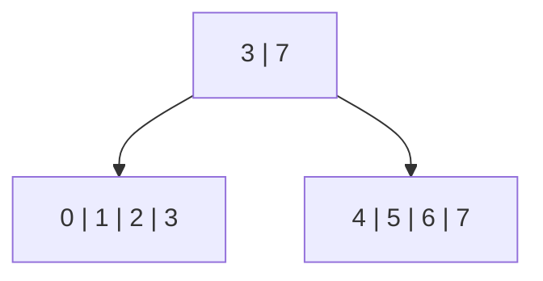

# Publishing the union article

**Edit the Markdown files under `content/posts/`** (this post lives at `content/posts/sublinear-set-operations-in-btrees.md`). It is the single source for the writing,
headings, code examples, Mermaid diagrams, and JavaScript canvas placements.
The build projects it into the styled HTML page. There is no HTML copy to maintain.

## Writing with live preview

From the repository root, run:

```sh
npm run dev
```

Open **http://localhost:4174**, edit the Markdown, and save. The page rebuilds and
reloads automatically, retaining the URL anchor and attempting to restore the
reading position. An invalid save shows a build-error message while keeping the
last good page available; fix the source and save again to recover. A reload
resets the interactive canvases to their configured examples.

Use normal Markdown for paragraphs, `**bold**`, `*emphasis*`, lists, tables, code,
and headings. Existing headings have a stable anchor suffix:

```markdown
## A clearer section title {#a-brief-b-tree-recap}
```

Change the words and leave `{#a-brief-b-tree-recap}` intact to preserve links.
New headings can omit the suffix and get an automatically generated ID. Duplicate
automatic headings get unique suffixes; duplicate explicit anchors are errors.

Interactive diagrams use a short directive; their implementation stays in JS/TS:

```markdown
:::btree recap #recap-tree
:::

:::btree playground #tree-playground
:::
```

Keep the existing explicit IDs when moving these two examples, since the page's
navigation links target them. Reusable `union-demo` embeds can be added without an
ID, or with a unique `#my-example` ID. Repeated embeds get independent canvases.

Mermaid diagrams remain ordinary fenced blocks:

````markdown

````

Use a `text centered` fence for a centered text range example. It centers the
whole monospace block while preserving the columns and indentation within it.
Wide examples scroll horizontally on narrow screens. Ordinary `text` and other
code fences keep their existing left-aligned layout.

For subscripts and superscripts, write `x<sub>i</sub>` or `n<sup>2</sup>` directly
in Markdown. These also work in headings, tables, and standalone spans, and can
contain Markdown emphasis. Match closing tags and do not add HTML attributes.
Matched `<sub>` and `<sup>` tags also render inside backtick-delimited inline code,
while preserving the surrounding monospace style. For example:

```markdown
`leading<sub>A</sub>, trailing<sub>B</sub>` and `n<sup>2</sup>`
```

Use one pair of backticks around the whole expression; do not put another pair
around the subscript text. Only bare, balanced sub/sup tags are interpreted there:
other HTML and Markdown syntax remain literal. Unmatched or misnested tags also
remain literal. Inside fenced code blocks, all tags remain literal examples.

Do not HTML-escape diagram text or number diagrams manually: the build does that.
Other raw HTML is intentionally rejected (except comments), so malformed HTML cannot
break the article shell; use Markdown or a BTree directive instead. The generic
Markdown editor may show the BTree directive as text—the browser preview renders
the actual interactive diagram.

## Static publishing

From the repository root, with Node.js 20 or newer:

```sh
npm ci
npm run build
npm run serve
```

Open **http://localhost:4174**. Set `PORT` to choose another port, for example
`PORT=8080 npm run serve`. The server serves only `dist/`, reports startup
errors, and does not fall back to another port or to the article for missing URLs.
`npm run serve` serves the last build without watching. Stop it before starting
`npm run dev` on the same port, or give the dev server a different `PORT`.

Upload **the contents of `dist/`** to any static host (see the top-level
[`README.md`](../../README.md) for the full route/asset layout):

- `index.html` is the complete article and playground mount point.
- `assets/` contains the bundled JavaScript, CSS, local Mermaid chunks, and bundled
  dependency license notices. Upload the entire directory, including its chunks.
- `LICENSE.txt` and `THIRD-PARTY-NOTICES.txt` retain the library and bundled package
  licenses and must accompany the published assets.

Asset URLs are relative, so publication under a subdirectory works. There are no
runtime CDN, remote font, or external asset dependencies: the locally served site
works without internet access. Use an HTTP server rather than opening `index.html`
as a `file:` URL, since browsers restrict module loading from local files.

## How it works

- `scripts/render-markdown.mjs` renders Markdown with Marked, including stable
  anchors, Mermaid fences, tables, and `:::btree` directives. Preset names and labels
  come from `docs/web/presets.json`; unknown presets fail the build.
- `scripts/build-docs.mjs` validates the projected HTML with parse5 and generates
  contents from Markdown section headings (`##` through `######`) in document
  order, using their current labels and explicit or generated anchors. Diagram
  and canvas IDs are never contents targets. It publishes assets first, then
  replaces `index.html` atomically. Old hashed assets are retained so a page open
  during a rebuild can still load its diagram chunks.
- `scripts/dev-docs.mjs` watches source files (not generated output), coalesces
  rapid saves, and serializes rebuilds. `serve-docs.mjs` injects the reload client
  only in development responses. The published files contain no dev connection
  or watcher requirement; `npm run serve` exposes no development endpoints.
- `template.html` supplies the blog-post shell, without a site navigation header,
  tagline, diagram-count caption, or footer. The author and publication month
  appear below the title; edit that byline in the template. The contents block
  follows as a single vertical list, left-aligned with the prose
  at every screen size. Its rounded background extends into the gutters to give
  the links breathing room without shifting their text. Contents appear only at
  the beginning, not in a sidebar.
  The current section is highlighted with `aria-current="location"` as the reader
  scrolls or follows anchors, including when lazy diagrams change section positions.
  Diagrams, code blocks, tables, and the playground use the wide page column;
  prose and contents stay in a centered, readable column.
- esbuild resolves local **TypeScript before JavaScript**. The playground therefore
  uses the current library source, not the repository's stale committed `.js`
  files. The library's legacy interface-only re-export resolves to `interfaces.d.ts`
  without generating an `interfaces.js` shim or modifying library sources. The build
  bundles the article and playground styles alongside the browser entry.
- The docs-only recording adapter captures the actual input cursor moves when an
  operation is created, retaining references to the real source nodes. Production
  library files are unchanged. Selecting an edge or scrubbing never reruns the
  operation. Unbundled model tests report an unavailable trace rather than inventing
  a walk; the documentation build wires in the recorder.
- For canvases with the decomposition list enabled, the build also inserts guarded observation
  calls into the private `decompose` function **in memory**, never in the production
  source file. They read its real emitted nodes/heights and pending exploded-entry
  buffer after each cursor movement. The final flush is captured before
  `buildFromDecomposition` runs. Immutable copies preserve each fragment's original
  structure even when reconstruction later splits it. Other canvases do not
  allocate these snapshots unless `display.decompositionList` is enabled. Frame
  snapshots share append-only histories rather than copying the entire growing
  list and pending buffer at every movement.
- Reconstruction uses the same in-memory instrumentation on `buildFromDecomposition`,
  `processSide`, and the cloning, split, insertion, leaf-repair, and metadata helpers.
  It records actual helper events, the current root/frontier, detached split carries,
  deferred size updates, and the consumed fragment interval. Versioned node snapshots
  retain earlier states while sharing unchanged subtrees. This recording is opt-in
  through `display.reconstruction`; the full playground and reconstruction examples
  enable it. Playback condenses these records to fragment selection (including
  target insertion height), node splits, and completed placements. Cloning, size
  bookkeeping, and individual pointer attachments do not require separate clicks.
  Neither phase reruns the set operation while scrubbing.
- `article.ts` renders Mermaid diagrams as they approach the viewport, one at a
  time. A broken diagram reports an explicit error without preventing other
  diagrams from rendering. Source remains available for every diagram, including
  when JavaScript is disabled.
- `article.ts` mounts every `[data-btree-example]` host using the presets in
  `examples.ts`. The opening `recap` shows keys and leaf values of the actual 32-key
  branching-factor-4 tree; the main `playground` retains its unlocked controls.
- The playground uses **D3 tree layout and zoom** to inspect real B+ trees. Its
  glass-box adapter reads BTree internals without mutating them; tree changes go
  through the library API. First-owner node identity tracks the original object
  owner across roots, making subtree reuse visible independently of the
  implementation's transitive `isShared` flags.

## Configuring article examples

The reusable entry point is `mountPlayground(host, options)` in `playground.ts`.
`PlaygroundOptions` is defined in `options.ts`. Omitted permissions preserve the
fully unlocked playground behavior; display options are independent of interaction
permissions.

The function returns a disposer that removes its listeners and viewport observer.
Mounting again on the same host disposes the previous instance automatically.

```ts
mountPlayground(host, {
  initialTrees: [
    { keys: [0, 1, 2, 3, 8, 9, 10, 11] },
    { keys: [2, 3, 4, 5, 12, 13, 14, 15] }
  ],
  initialOperations: [{ operation: 'union', left: 0, right: 1 }],
  selectedOperation: 2,
  permissions: {
    addTrees: false,
    deleteTrees: false,
    moveTrees: false,
    combineTrees: false,
    cloneTrees: false,
    addElements: false,
    removeElements: false
  }
});
```

Initial keys must be sorted and unique; optional `values` must align with them.
The initial-tree list can also contain `{ cloneOf: 0 }` to clone an earlier entry
using its zero-based creation ID. Clone references must point backward to an
existing tree; they can refer to an earlier clone. For example:

```ts
initialTrees: [
  { keys: Array.from({ length: 16 }, (_, key) => key) },
  { cloneOf: 0 }
]
```

These are separate BTree wrapper instances sharing the exact same root object,
not two independently bulk-loaded copies.

Omitting `initialTrees` uses the original article pair, while an empty array starts
with no trees. Initial operations reference zero-based creation IDs and execute
through the real BTree library, regardless of which subsequent UI actions are
disabled. `selectedOperation` optionally starts a prepared result in its T-1 view.
`initialTimelineStep` defaults to `-1`; set it to `0` to start with both cursors
at their first keys. Nonnegative steps require a selected operation and enabled
timeline navigation. Steps past the recorded walk clamp to its final frame;
fast paths and unavailable recordings still show T-1 without fabricated cursors.
`initialTimelinePhase` defaults to `decomposition`. Set it to `reconstruction`
with `display.reconstruction: true` to begin at R0 (or `initialReconstructionStep`).
Reconstruction needs a selected operation and enabled timeline controls.
Set `pinSelectedOperation: true` to keep that operation selected while inspecting
individual nodes. Node selections add a dashed outline without changing reuse
colors or output brackets; clearing them retains the pinned operation. Editing or
removing a participant can still invalidate the operation.

`autoCenter` defaults to `false`. When enabled, opening a context menu and editing
an element pan to the selected node; creating/cloning trees or starting an operation
also reframes the view automatically. Only the first (`recap`) diagram enables it.
All examples fit their contents once at initialization, and explicit **Center**,
**Fit all**, and zoom controls remain available regardless of this setting.

`initialLayout` is `horizontal` by default. Set it to `vertical` to stack initial
trees in creation order with aligned horizontal centers. The `sharing` example
uses this setting; the main simulation retains its side-by-side inputs. Prepared
operation results are still placed below their inputs.

| Permission | Controls |
| --- | --- |
| `addTrees`, `deleteTrees`, `moveTrees`, `combineTrees`, `cloneTrees` | Individual tree actions |
| `addElements`, `removeElements` | Adding/removing entries in an existing tree |
| `treeMenus` | Tree action popups |
| `selectNodes`, `selectOperations` | Identity/sharing selection |
| `timeline` | Decomposition/reconstruction playback for the selected operation |
| `pan`, `zoom` | Viewport gestures and corresponding keyboard/buttons |
| `wheelPan` | Whether ordinary scrolling pans the canvas instead of the article |

Display flags are `toolbar`, `help`, `treeHeaders`, `treeFrames`, `nodeMetadata`,
`leafValues`, `grid`, and `frame`. `leafValues` defaults to `false`; set
`display: { leafValues: true }` to show a value row below the keys in each leaf.
Internal nodes never show values. Values are read from the actual BTree leaf,
quoted as strings, and sized to fit their cells. Metadata, when enabled, has its
own row. The recap enables values (`"v1"` through `"v32"`, paired with keys 0
through 31); the main simulation keeps them hidden.
`colorMode` is `provenance` by default or `levels` for blue
internal nodes and green leaves. `height` sets the viewport height in pixels.

For Markdown authoring, place a registered preset wherever the diagram belongs:

```markdown
:::btree union-demo #my-union-example
:::
```

Presets live in `examples.ts`: `playground` keeps the full UI, `recap` shows only the
three-level 0..31 tree with two root children, `sharing` starts with a full 16-key
tree and its clone, `small-overlap`, `large-overlap`, and `alternating-overlap` illustrate the range examples,
`step-timeline` exposes the small-overlap cursor walk, `reconstruction-min` and
`reconstruction-max` open reconstruction examples, and `union-demo` prepares two inputs and their union
without editing controls. Register its name/default ID/label in `presets.json` and
add its factory in `examples.ts` to combine different initial
data and permissions. Each embed owns its model, IDs, viewport and selection state.
The recap has Zoom in, Zoom out, and Fit all buttons, with Add element and Remove
element in its tree menu, but no Add tree, Delete tree, or Combine controls.
It retains drag/pinch/zoom navigation; ordinary wheel scrolling continues
through the article. There is no fullscreen control in any preset.

`:::btree small-overlap #tree-small-overlap` uses all integer keys in `0..50` and
`45..100`, overlapping only in `45..50`, with their `0..100` union as the third tree.
`:::btree large-overlap #tree-large-overlap` retains the multi-overlap example:
inclusive ranges `0..10, 20..30, 40..50` and `5..15, 25..35, 45..55`, plus their real union.
`:::btree alternating-overlap #tree-alternating-overlap` uses 20 even keys (`0, 2, ..., 38`)
and 20 odd keys (`1, 3, ..., 39`), plus their `0..39` union. There are no equal keys,
but every cursor-step segment contains only one key, so no input nodes are reused.
All three presets use the same display. The union edges start selected in the T-1 summary:
all reuse shading and output sequence numbers are visible, with no cursor markers.
Cursor timeline navigation is hidden and the union selection is pinned.
Selecting an individual node adds a dashed outline to every occurrence of that
exact node object in the example's trees, not its descendants. Reuse colors,
union edges, and complete cursor-step segments stay visible. Click or use
Enter/Space on a focused node; Escape or a background click clears only the node
outline, leaving the union summary intact.
Editing, tree menus, and operation selection remain disabled; pan, zoom, and Fit all
remain available.
With the preview running, `node scripts/test-overlap.mjs` exercises all three read-only
scenes' data, selection, hidden timeline, disabled mutations, and responsive viewports.

`:::btree step-timeline #tree-step-timeline` extends the small-overlap inputs with
key 88 in Tree1 (`0..50, 88`) and key 22 in Tree2 (`22, 45..100`); the union remains
`0..100`. The visible timeline starts at T-1 with all segment underlines and no
cursors. Advance to T0 to place the input cursors at 0 and 22. Previous/Next and
the slider navigate the recorded walk and return to the T-1 summary. The union
stays pinned and nodes remain selectable without editing, menus, or tree movement.
The decomposition list is enabled below the result; reconstruction and its phase
selector remain disabled in this example.
The overlap browser check also covers this example's initial frame and navigation.

`:::btree slice #tree-slice` uses the same read-only, decomposition-only timeline
setup, with Tree1 containing all 200 keys in `1..200` and Tree2 containing only
`122`. The third tree is their real union, still `1..200`, keeping Tree1's
value at the matching key. It starts at T1, after the first cursor jump to 122,
with the union pinned and the decomposition list visible. Reconstruction, editing,
and tree menus remain disabled.

The actual decomposition list is shown below the union output, aligned to its left
edge. Its ordered fragments stay in one horizontal row, extending past the
output's right edge as needed. A padded, rounded beige backdrop at 20% opacity
surrounds the list without fading its contents and is included in Fit all.
Reused subtrees retain their input colors; newly
formed leaves use the union result's color, are labelled "Exploded leaf", and show
their keys and values. Pending exploded entries are shown separately
at the end until the algorithm flushes them into leaves. Heights come directly
from decomposition, including `-1` for an underfilled leaf.

T-1 shows the complete pre-reconstruction list; T0 starts empty. Scrubbing forward
adds the real emitted fragments and updates the pending buffer; scrubbing backward
restores the captured state without rerunning union. Fit all includes the list,
and its position follows the result when the canvas pans or zooms. Reused nodes in
the list can be selected to highlight matching input/result pointers while the
union remains pinned. No editing or tree menus are enabled.

`:::btree reconstruction-min #tree-reconstruction-min` preserves the original
reconstruction example, using the same inputs and decomposition as `step-timeline`.
`:::btree reconstruction-max #tree-reconstruction-max` uses the 20 even keys
`0, 2, ..., 38` and 20 odd keys `1, 3, ..., 39` from `alternating-overlap`, with
their `0..39` union. Its decomposition consists entirely of new leaves, with no
reused input nodes.

Both start in reconstruction at R0, with the complete decomposition list, pinned
union selection, and editing disabled. A single **Phase**
selector retargets the existing slider and Previous/Next buttons; it remembers
independent T and R positions, and never crosses phases automatically.

While reconstruction is selected, decomposition is displayed at its completed
state: the whole list and input segment underlines are present, with no input
cursor markers or trails. Switching back restores the previously selected T
position. The complete list stays in place throughout reconstruction. The current
fragment has a strong amber outline and a Current badge, including the seed at R0.
Used fragments retain green headers and Used badges; the list shows a used/total
count. Outlines remain legible when zoomed out. Rewinding restores the earlier
statuses without removing or repositioning fragments or changing their node colors.

R0 shows the tallest seed fragment **inside the existing output tree box**.
Intermediate roots and detached carries replace its final tree drawing without
moving or resizing the box. Leaf keys are anchored to their final key slots, so
unchanged subtrees and the initial seed do not recenter when either side grows.
Splits and merges change only the affected structures. The last R frame restores
the exact normal output-tree drawing. There is no second result box below the list.
The active path is gold, changed nodes are orange-outlined, and nodes awaiting
placement have dashed outlines. Selecting a fragment highlights its insertion
target in green and labels its height. Short captions describe selection, splits,
and placement; leaf merging or rebalancing is included in the placement step.
The final placement also completes the timeline, without an extra bookkeeping step.
Detailed helper snapshots are retained internally, but not exposed as individual
slider steps or lengthy descriptions.

The published `dist/<post-slug>/` remains self-contained: private decomposition code and
its observer are bundled into the static assets, not loaded from the repository
or a service at runtime. Copy the complete site directory (including assets and
license notices) to another repository or static host. The authoring/build project
still needs this library source; this integration does not make source imports
independent of the library checkout.

The full playground enables both phases. Select a union or subtraction connector
to inspect that operation's real list and scrub either timeline.
Exploded leaves use the selected result tree's color. Intersection uses a different
algorithm and explicitly reports that it has no decomposition list. Its reconstruction
option is disabled, as it is for fast paths and empty subtractions that skip
`buildFromDecomposition`; no reconstruction steps are invented. Editing or deleting a participant
invalidates its recording, while unrelated operation lists remain available.

## Developing the playground

`npm run docs:check` type-checks the browser entry and the library code it uses.
`node scripts/test-markdown.mjs` exercises the Markdown projection and authoring
syntax. `node scripts/test-docs-dev.mjs --browser` checks save/reload, error recovery,
and scroll/anchor restoration using temporary fixtures rather than the article.
After building, `node scripts/test-markdown.mjs --site` checks that the published
contents match the current section headings, every local link resolves, and the
removed site header, tagline, diagram-count caption, and footer stay absent.
Run the docs-only recorder checks without a browser or server:

```sh
node scripts/test-timeline.mjs
```

This builds recorded and unrecorded model bundles with the shared docs plugins,
compares results, structure, and sharing flags, and checks immutable frames,
key-slot routes, equal-key movements, END ascent, fast paths, deletion, and nested
or failing callbacks. It also exercises 72 varied operation cases. The unbundled
model Jest tests intentionally receive explicit unavailable timeline metadata.

With the built site running, exercise the live diagrams and controls with:

```sh
npx playwright install chromium
npm run docs:test
```

Set `DOCS_URL` when using a different preview URL. Screenshots are written to the
ignored `docs/test-results/` directory. The existing Jest runner also covers the
canvas model in `test/playground.test.ts`.
With the preview running, `node scripts/test-element-edits.mjs` exercises exact
hover/focus edit previews, display-only key rounding, selected-node centering and
popup placement, captured edit ranges, singleton/empty/read-only limits,
independent canvases, and retained result trees.
`node scripts/test-clones.mjs` checks the live sharing example, real clone identity,
lazy sharing flags, mutations and cloned-tree operations in both canvases.

The interactive section is just the canvas. Drag the background or scroll to pan.
Ctrl/Command-scroll and pinch zoom around the pointer; buttons and keyboard
controls provide alternatives. Drag title bars to move trees; overlapping trees
does not perform an operation. There is no fullscreen button.

**Add tree**, beside Fit all, opens a floating generation menu.
Choose a size and starting key for consecutive integers; enter inclusive ranges
and single keys such as `-5..5, 40..55, 90`; or request an exact count of unique
random integers within inclusive bounds. Overlapping ranges are deduplicated.
Random generation has a reproducible numeric seed and a New seed button. A live
preview shows the resulting key count and a sample.

Click a tree's title/background or a specific node to reveal **Center**, **Clone**, **Combine
with another tree**, **Add element**, **Remove element**, and **Delete** (when enabled).
In the recap, click any node to open its tree menu. On a keyboard, focus the tree's title or recap node and press
Enter to open its actions. Hovering or focusing alone does not open a menu.

**Clone** creates another BTree instance using the library's real `clone()` method.
Initially every node is shared by identity and keeps its original owner color;
the root's `isShared` flag is true while descendant flags remain lazy. Both trees
remain independently editable through copy-on-write. Clone is available in the
sharing example and full simulation, but not in the intro recap or frozen union
example. The sharing example also allows element edits and additional clones;
there is no generated-key or binary-operation menu in that example.

The menu opens centered horizontally on the selected node, preferably above it.
If there is not enough room above, it moves below or clamps within the canvas,
staying clear of the toolbar.
Its edit range is captured from the minimum and maximum **descendant** keys,
including for internal nodes; clicking a tree title/background selects its root.
Add element picks an unused decimal key within that range, using concise decimals
where possible without rounding outside the bounds. For a singleton selection,
insertion uses the interval one unit below and above its key. Values use unused
`vN` strings. Remove element picks only from existing keys inside the captured range.
It is disabled when that range has no keys left or the entire tree has only one key.
Both actions are disabled for an already-empty tree.

Hover or keyboard-focus **Add element** to preview its insertion boundary in the
actual target leaf. **Remove element** highlights the exact key and its cell.
The preview prepares a key without changing the tree, values, or operation history;
clicking applies that same key, not a new random choice. Add and Remove retain
independent prepared targets, so switching between them does not reroll either
candidate. Center and zoom also preserve those targets. An edit or a new node
selection invalidates both plans. After an edit, a still-hovered or focused action can preview
its next target. Leaving the action clears its preview unless the same action
remains focused; closing the menu or disabling the action also clears it.

Key labels and edit status messages round to at most two decimal places, without
trailing zeros. This is display-only: stored keys, comparisons, captured bounds,
and preview targets retain their numeric precision. Distinct keys can therefore
have the same displayed label; SVG key labels expose the raw number in `data-key`.

Repeated edits retain the selected range even if the original node splits, merges,
or is copied. Select another node to choose new bounds. These operations edit the
selected BTree through its normal copy-on-write API; existing result trees remain
unchanged.
With `autoCenter: true` (the recap), opening the context menu and each subsequent
edit automatically pans to the selected node or its current representative.
Other examples preserve the current view until you request centering.
**Center** always uses the same placement: the menu
sits near the canvas top (below the toolbar when necessary), with the selected node
centered horizontally immediately beneath it. This leaves room for descendants
below while preserving zoom and the tree's position.
If the original node survives, it remains the anchor. Otherwise, the smallest
current subtree containing the captured range's surviving keys becomes the anchor;
if none survive, the nearest leaf does. Layout dimensions may change as keys are
added or removed. **Fit all** still frames all trees and closes the menu.

Editing an input or result invalidates its directly affected operation connectors
and recorded timelines, rather than silently recomputing other trees. Unaffected
downstream operations retain their existing inputs. Reuse colors of surviving
objects remain stable; newly allocated nodes belong to the edited tree.

Combining trees is only available through these tree actions. Choose Combine,
then click another tree (or focus its title and press Enter). The first input is
outlined blue; the second is outlined orange. Pick union, subtraction, or
intersection and press **OK**. Subtraction uses first minus second; union and
intersection keep the first input's values for matching keys. Escape or Cancel
abandons either selection step. Add tree can also interrupt selection.

Interactive trees are named **Tree1, Tree2, …**, including generated trees and
operation results. These names are distinct from cursor timestamps **T0, T1, …**.
Generated trees use bulk loading with branching factor 4 and values such as
`t3:90` to identify their source. They are independent BTree instances and can be
combined immediately, just like operation results. Each generation is limited to
10,000 unique keys for interactive rendering; invalid input leaves the canvas
unchanged. A size of zero generates an empty tree.

Click a node to shade every occurrence of that exact object in the same highlight
color, without opening a details panel. This still selects only that node, not its
descendants.

Click either thick connector for an operation to shade nodes shared by **the
result and at least one input**. Nodes shared only between the inputs are not
marked. Only occurrences inside that operation's three participants are marked,
not copies in unrelated trees.

Each maximal connected reused subtree takes its root's original owning-tree color,
matched across its occurrences in the inputs and result. For each owner, chunks
alternate between the original color and a darkened version in left-to-right key
order. A reused parent and child have the same shade, and their connecting edge is
colored too. Reused siblings are separate chunks unless their parent is also
reused. Chunk roots have a heavier outline. Shades stay stable while panning,
zooming, or reselecting the same operation. Selecting an individual node uses its
owner's original color with a stronger outline.

Operation connectors carry readable labels such as `subtract Tree2 from Tree1 → Tree3`.
Labels move along their curves with the trees, prefer positions clear of tree
cards and other labels, and can be clicked just like the connectors themselves.

While an operation is selected, red brackets beneath the leaf row number the
**entire output sequence** from 1 in sorted key order, independently of owner
colors. Each recorded cursor movement that completes new output keys produces
one segment. A segment can span multiple reused subtrees, standalone leaves, and
fresh key cells: subtree boundaries never split it. In the small-overlap example,
the first move from 0 to 45 produces one segment covering `0..44`, including the
partial leaf containing key 44. The destination key is not included until it is
passed. Whole-leaf endpoints align with the leaf edges; endpoints inside a leaf
are inset 3px from their key-cell boundaries. Together the result's spans cover
every output key exactly once. Empty outputs have no segments.

The same segment numbers appear on participating inputs, independent of whether
their leaves are reused or rebuilt. Equal keys in
both union or intersection inputs share the same output number. Removed keys and
intersection-exclusive keys are unmarked; subtraction's right input has **no red
sequence annotations**. If only disconnected parts of a segment appear in an input,
each contiguous part gets its own bracket with the same number, never bridging
unrelated leaves. Numbers shrink to fit short spans. No spans appear on unrelated
trees. Clearing selection removes the brackets, and an individual-node selection
has no sequence numbers. Reuse shading, connected chunks, and alternating owner
fills remain separate from this output numbering.

Selecting a connector or its label also opens a floating **Cursor timeline** inside
the canvas. It starts at **T-1**, with all output sequence spans and no cursor markers.
Drag the slider, use its arrow keys/Home/End, or use Previous/Next to scrub in either
direction. **T0** places both yellow, red-outlined cursors at their first input keys,
with no brackets or ghosts. Each subsequent step is one completed cursor movement;
equal-key movements are separate steps, and sides need not alternate.

Each circle is centered on its leaf's bottom border, horizontally aligned with
the actual key slot, and contains the time that cursor last moved. A short stem
points upward to just below the key text; the circle stays clear of the key.
A cursor keeps its previous position as a faint dashed ghost, labelled with
the previous movement's time, and its most recent route as a 30%-opacity red line.
Routes connect the leaf-border cursor anchors through the recorded internal key
slots, including ascent and descent; same-leaf moves stay horizontal. Exhausted
cursors finish at **END** beside their input root, without a key-pointing stem.
Their recorded movement trail remains ascent-only. A **separate** 30%-opacity red
completion line starts at the END circle center, visits the last key in the real
input root, then follows last-child/last-key slots to the maximum key of the
rightmost leaf. All its key points use the key row's vertical center, including the
final leaf rather than its bottom-border cursor anchor. This line indicates that
all input keys have been passed; it is not part of the recorded move and does not
follow the old cursor's spine. It exists only while that cursor is at END and
disappears when rewound before exhaustion.
Intersection can stop with only one exhausted cursor; the other stays at its last
recorded key and time. There are no output cursors or output completion lines: the
result tree remains in its final shape during the decomposition phase.

At T0 and later, matching input/result sequence spans appear together only after
both cursors have passed the output item's maximum key (END counts as positive
infinity). The boundary is strict: an item's maximum must be less than both current
cursor keys. Even a partial input span waits for its entire output item's maximum.
Each movement reveals at most one new segment number, no matter how many reused
subtrees it crosses. Equal-key moves that do not advance the completed prefix
create no segment; the matching key appears once both cursors have passed it.
Owner shading, shared edges, and reuse-root borders stay visible throughout.
Scrubbing backward removes the same spans; returning to T-1 restores all of them.
Panning, zooming, and moving trees preserve the selected time. Selecting
a node, clearing selection, or closing the timeline dismisses it.

Fast paths keep the slider disabled at T-1, show no cursors, and report
**No cursor walk: fast path.** With no recorded movements, static numbering uses
reused blocks and individual remaining output keys instead. An unavailable
recording is explicitly identified and uses the same static numbering, with no
fabricated cursor steps.

Connectors have a wide click target and also respond to Enter/Space when focused.
Escape or a background click clears the selection and restores the original
provenance colors.

Trees and their positions are in-memory and reset on page reload. There is no
fixed limit on the number of result trees; rendering cost grows with their nodes.
Deleting a tree removes only its canvas entry, not trees derived from it. Both
connectors disappear for every operation directly involving that input, so those
timelines can no longer be selected. Deleting a result also removes its incoming
connectors and any operation connectors that use it as an input. Unaffected
downstream operations remain selectable when both immediate inputs still exist.
Result labels retain the original input names. IDs and colors are not recycled,
including after the last tree is deleted.

Ownership is per canvas: trees are scanned oldest-first, breadth-first, and a
surviving object's first owner/color is never reassigned, even when that owner is
deleted. Node labels retain their original owner IDs. Unreachable node records are
released, and owner metadata does not retain the removed BTree. Color identifies
provenance, not the value of `isShared`; node numbers provide a non-color identity cue.
